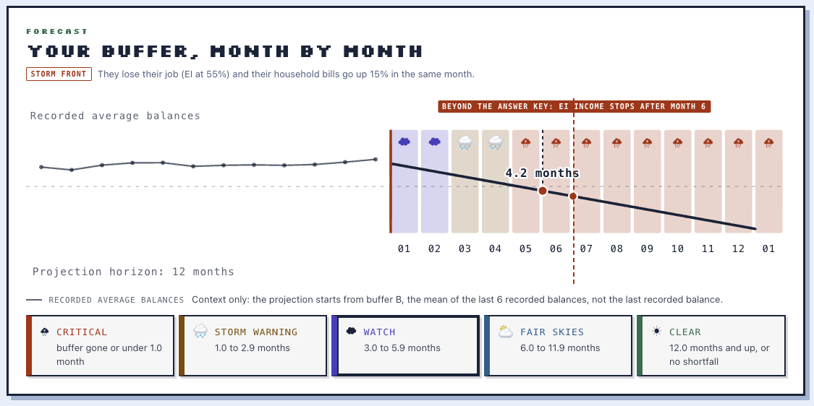
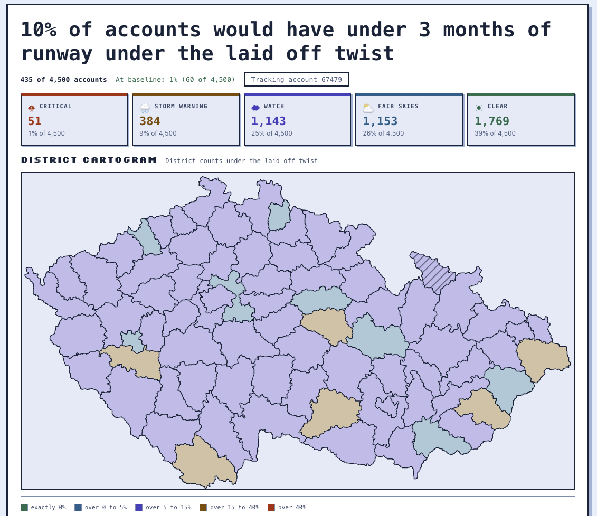

# Storm Fund: A resilience weather station for bank customers

**Winner of Best Use of Solana.**

See your money move like weather.

Storm Fund is a resilience financial engine that visualizes a bank account as a real-time weather forecast. Anonymized bank data maps runway and buffer to a pixel sky. Inject a shock and watch the forecast change.

## Screenshot

*[Placeholder: screenshot of the title page showing the pixel sky and UI]*

## Primary Features

1. **Account Runway Analysis**: Income, fixed costs, spending, savings buffer, household bills, loan payment, and months of runway for any account_id.
2. **Shock Simulator**: Apply a job loss with EI, a furnace repair, a bills increase, or any mix, and recompute runway live.
3. **Make a plan**: Build an emergency fund goal plan and a shock backup plan based on the account's numbers.

## Demo video

Watch the 2 minute demo: https://youtu.be/1mc1r3SXIkU

## Full Feature breakdown

Everything below describes the shipped site, mapped to the seven build phases in AGENTS.md.

### Know the customer: account profile

Search any of the 4,500 `account_ids` in the dataset and the console loads a precomputed baseline profile: income (I), fixed costs (F), spending (S), savings buffer (B), household bills (H), and loan payment (P). The definitions are the answer key's: I, S, H, and F are medians over all monthly rows (F is the median across months of the per row sum of household bills, insurance, and loan payments), B is the mean of avg_daily_balance over the last 6 recorded rows, and P is the loan's monthly payment only while its status is C or D, otherwise 0. Every money value is an integer in CAD cents and every runway is tenths of a month, rounded half up once at the metric boundary.

Each profile carries a recorded `check_sum` (SHA256 over its account_id:month rows paired with money in cents) that the baseline card prints as recorded: the page shows what the pipeline wrote and never claims to have reverified it. The loader validates the schema field by field and refuses drift instead of guessing.

Everything is precomputed offline into `public/data/engine/profiles.json`, so any account answers instantly with one bundled fetch and zero network calls.

The gate around it is `uv run python -m scripts.engine.verify`: an independent naive recompute straight from the raw CSVs that shares no code with the metrics module, a scan for banned dash characters, and the printed artifact SHA256 `9ec428bf1a78b35703aa3d36311d4ee061eac7fbd1176cfcbf111acc5c40a858`, exiting non zero on drift. Five hand computed golden fixtures (accounts 68257, 23838, 49900, 98952, 42988) cover every runway branch and every edge flag, and two consecutive builds of unchanged sources are byte identical.

The artifact publishes its five edge flag counts too: pensioner 740, thin_history 377 (row count under 18), zero_income 14, defaulted_loan 45 (loan status D), negative_buffer 23.

### Take a shock: shock simulator

Four one-click twist cards reproduce the brief's example shocks: Laid off (EI pays 55 percent of usual income for 6 months), Bills up 15 percent, Furnace repair (one full month of typical spending), and the combined Laid off and bills up. Four sliders size any shock by hand: income after shock, household bills change, one-off cost in months of spending, and extra monthly cost.

The runway formula runs in integer cents with the exact branch order from the brief: buffer left after one-off costs, monthly gap between shocked spending and shocked income, runway of 0 when the buffer is gone, "no shortfall (120+)" as its own state when income covers spending, otherwise months capped at 120 and rounded to one decimal. The TypeScript implementation mirrors `scripts/engine/shocks.py` branch for branch and is validated against the golden fixtures plus a cross-check of all 4,500 profiles, so the number on screen and the number a judge computes by hand agree.

The verdict comes from one pure `verdictBand` function in `src/lib/verdict.ts`: five bands (critical, storm warning, watch, fair skies, clear) cut at 10, 30, 60, and 120 tenths of a month, with buffer depleted always reading Critical and no shortfall always reading Clear. The mode badge always shows where the input came from: preset cards or a typed sentence. The console's honest template plan text comes from the same single derivation, so the words on screen always match the numbers.

### Make a plan

Two plans derived from the customer's own numbers, both printed as the declared definitions the brief allows us to choose.

The emergency fund goal plan targets 3 months of typical spending as the starter cushion, with a 6 month stretch cushion beside it and milestone chips at 1, 2, 3, and 6 months of spending. The monthly contribution is the larger of income minus spending and 5 percent of income, months to the target are counted from zero new savings, and savings on hand are disclosed in the definition strip instead of being quietly netted off. Status words are on track, cut needed, and needs income.

The shock backup plan judges the shocked runway against a 6 month horizon and names the cut floor as fixed costs F plus loan payment P, so no lever ever suggests skipping a bill that cannot be cut. Under it runs the ordered lever ladder: shop insurance, trim discretionary spending above the F plus P floor, then defer the loan. Every "+N months" figure is the difference between two separate runway computations, never a second copy of the formula, and every row carries a simulated counterfactual label stating its assumption.

The frozen plan goldens live in `scripts/engine/golden_plans.json` and are asserted by both vitest and pytest, with `scripts/engine/plans.py` as the Python twin, so a rule change in one language fails the suite in the other.

### Weather station visualization

The forecast strip is a projection built from integer cents: a balance curve from the shocked buffer, a storm front at the landing month, and a landfall pin whose printed figure is the same headline runway the verdict badge shows. The horizon starts at 12 months, extends to the landfall month, and is capped at 120. Recorded average balances are drawn muted to the left of the projection as context only, beside the honesty note that the projection starts from buffer B, the mean of the last 6 recorded balances, never from the last recorded balance.

The EI cliff overlay appears only under a job loss twist, is labeled "Beyond the answer key: EI income stops after month 6", and draws a dashed worst case continuation to a second pin. It is display only: it never reaches the headline verdict, the pin, or the plan text.

A band key prints all five verdict bands with their thresholds, lowest runway first. Colors are colorblind safe (Okabe-Ito base), severity is carried by color plus icon plus text label together, and every animation respects prefers-reduced-motion.

### Typed shock input

Instead of preset buttons, type the shock in plain language ("they lose their job, EI covers half, and the furnace dies next month"). The Gemini parse maps the sentence to the same structured shock fields the presets use, shows them as confirmation chips you can correct with one click, and prints the dollar arithmetic in a formula strip that delegates to the same shock math, so you can hand verify it before anything applies. The runway never changes until you confirm, and a parse that fails, lacks a key, or times out after 3 seconds falls back to a note while the preset cards stay clickable. The engine runs fully without it. Full details in the Use of Gemini API section.

### Storm Atlas

Where the station shows one account, the Storm Atlas shows the whole population. The headline quotes the number the pitch asks for: accounts under 3 months of runway, which is 1 percent (60 of 4,500) at baseline and 10 percent (435 of 4,500) under the laid off twist. The scenario label is derived from the same twist object the counts ran through, so the sentence can never claim a shock the math did not apply, and a scenario mode runs the entire population through `applyTwist` again whenever the live twist changes.

The distribution renders as a strip plot with one dot per account (4,500 circles) on an axis aligned to the verdict bands, with deterministic jitter seeded from the account id (never random) and a labeled 120+ overflow bin for capped readings. Click any dot to drill straight into the console on that account, which is how the demo moves from one judge-picked account to the population story.

An extension adds a district storm cartogram (77 districts) and a population rain gauge, both rendered from `public/data/engine/atlas.json`, precomputed on the five verdict bands by `scripts/engine/atlas.py`. The summary math lives in pure modules with unit tests, and the components read counts, never recompute them.

### Solana receipt badge

Three finalized devnet memo transactions anchor the analysis: the findings.json root, the model_card.json hash, and the F1 aggregate fingerprint (aggregates only, no raw rows). Their evidence files are bundled into `public/data/` at build time and read by `ReceiptStamp` in the baseline card through a build-time glob, so the badge never makes a network call and renders the same with the booth wifi off. It reads "Anchored on Solana devnet, verified" when the memo text read back from chain matched byte for byte, "anchored at build time, signature: ..." otherwise, and "no evidence yet" before an anchor exists. Digest honesty tests recompute the SHA256 of the shipped findings and model card bytes and compare them to the bundled digests. Full rationale in the Use of Solana section below.

## Use of Solana

Solana provides the provenance layer for the findings: a tamper-evident, independently checkable record that the exact analysis we presented is the analysis we ran. The integration is deliberately small (memo transactions only, locked scope in `docs/decisions.md`), it runs entirely on devnet, and all three receipts are finalized on chain:

- **findings.json root**: signature `5YPxwK9dobRKeaVdrVsSGdCcXe4dQ7T8ffm7okDEUNhHb5SEL7g65efLrB17FcoqGJWbKqDrU2D2Ka1Ltnnnxstg`, pinning digest `48bb57a409459812ae2bfead9ae688bf5d38b4c4786dabf15e1e05d52b8b3bc3`, the SHA256 of `public/data/findings.json`.
- **model_card.json hash**: signature `3BJiraS5t8nogZaKRBMLrnCgipSadp7cMN3HJpyK7dfMkjB73BAV8RrPnRLHtSRvkrcKMSk752wyT8ihtbJx5APX`, pinning digest `b3b32f0c0f284c3cac2e3df6e7d680fc53a5313b206750053f838853b9a0efe3`, the SHA256 of `public/data/model_card.json`.
- **F1 aggregate fingerprint**: signature `Q7evLcRboSd5xkgesg4PJKBixwono2WagquCp1ifMD5rNxKUVsd599P8pYw1VBP4o4dRnYeMni7rAhYoMA3Lrwn`, pinning digest `84f5f24be8f1c74e3ca645fdebfd0f41e52f916c0cc84f6059ada2554138cccd`, the SHA256 of the published F1 aggregate table, with the note "aggregates only, no raw rows".

How it works:

- **What goes on chain is digests, never data.** Each memo carries the SHA256 hash of a frozen artifact. No account id, no balance, no row of customer data ever appears in a transaction. The chain pins the identity of the artifact; the artifact itself stays in the repo.
- **The send path is audited, not improvised.** `scripts/solana/send_memo.py` refuses to sign until it has confirmed the endpoint is genuine Solana devnet (genesis hash assertion), sends the memo, confirms the transaction, reads the text back from the chain, verifies it matches byte for byte, and writes an evidence file with the signature and explorer URL. A known test string with a recorded digest lets us self-test the whole path before touching the real file.
- **The site never touches the network.** The three evidence JSONs are inlined into `public/data/` at build time by `import.meta.glob` and rendered by `ReceiptStamp` in the baseline card, which reads bundled bytes only: zero runtime RPC calls, so the demo works with the booth wifi off, and there is no wallet, no Anchor program, and no tokens anywhere in the project.
- **Digest is tested.** The vitest suite recomputes the SHA256 of the shipped `findings.json` and `model_card.json` with node crypto and fails if either differs from the digest bundled in its receipt, so an artifact that changed cannot keep an old badge.
- **Track Eligibility** The findings freeze and the chain anchor happen at the same moment: the number you show a judge and the hash on chain are the same bytes. Anyone can run `shasum -a 256 public/data/findings.json` in our repo and compare it to the explorer transaction to verify we did not quietly recompute after judging.

Booth line when a judge asks why the chain: "we anchored the findings themselves on chain because that is the claim that needed the chain; everything else stayed on the honest side of the line."

The labeled future work sentence in the Devpost "Limits we declare up front" reads: "future work: a behavioral score attested on chain could gate a credit line or automate surplus sweeps; not implemented, and the underlying model (F3, AUC 0.590) is not strong enough to gate credit".

## Use of Entire

Entire was in place before this repo's first commit. `entire enable -y --agent opencode` ran before commit `1300799 chore: initial repo with Entire enable files and Tangerine dataset manifest`. The enable files (`.entire/settings.json`, `.entire/.gitignore`, `.opencode/plugin/entire.ts`) and the Graph agent guide (`.entire/agent-guide.md`) ship in the repo.

- **Graph first, across all seven phases.** `.entire/agent-guide.md` is injected into AGENTS.md, so every agent session auto-loads the rule that the first action on a code task must be a Graph query. `entire graph query` finds code for a description, `entire graph def` shows a symbol, `entire graph neighbors` lists callers and callees (`--direction in` or `out`), and `entire graph impact` gives the blast radius before a symbol changes; the guide also covers Graph diff, commit, and checkpoint for semantic comparisons of revisions. That discipline ran through phases E1 to E7 and through the concurrent sessions that worked the atlas, the docs, and the receipts in parallel.
- **`--head` told committed from in flight.** The flag queries the committed tree from cache while the default reads uncommitted edits, so parallel sessions could tell what had landed apart from what was still on the bench. Query-time Coverage lines name what the indexer skipped rather than leaving a silent gap, and they named the generated files honestly: profiles.json as too large, transactions.json as minified. `entire graph health` reports index state (the rehearsal measured 71 source files indexed in 1204 ms).
- **Checkpoints and transcripts sit in the git history.** Commits made during agent sessions carry an `Entire-Checkpoint` trailer naming the session checkpoint, checkpoint snapshots are stored as commits under `refs/entire/checkpoints/`, and `entire checkpoint explain HEAD` reconstructs a commit's intent and transcript, so the finished history interleaves the code with the session that wrote it.
- **Token cost stays visible.** `entire session tokens` reports per-session input, cache read, output, and API calls, and `entire tokens profile --json` aggregates usage across checkpoints, which keeps a multi-agent workflow's cost visible. `entire trail create` offers title-branched trails for review; this project stayed on `main`.

## Use of Gemini API (Feature Scrapped)

The Gemini API powers the typed shock input, and nothing else. One structured request maps a free-form sentence to the exact shock parameters the calculator uses, through a strict JSON response schema with seven required keys and no extras: intent (job loss, bills up, one-off cost, mixed, or no shock), confidence, income factor, bills percentage, one-off cost in months of spending, duration, and a summary. The model is pinned to `gemini-3.5-flash-lite`.

- **The model is a parser, not an oracle.** It never computes runway. Its output is shape checked, percent corrected, clamped, and rounded in TypeScript (`src/lib/shockParse.ts`), then shown as confirmation chips. A no-shock mapping, low confidence, and an all-neutral mapping are each rejected before anything can apply. The rules engine does all math, and the runway does not move until a human clicks confirm.
- **The formula strip shows the dollars.** Before confirming, the pending spec is run through the same `applyTwist` the console uses, so the income, bills, spending, one-off, and buffer figures you hand check are exactly the ones the verdict will use.
- **Graceful failure is designed in.** One fetch attempt with a 3 second `AbortSignal` timeout, no retry on rate limits, a missing `VITE_GEMINI_KEY` that rejects without ever fetching, and preset twist cards that stay clickable at every moment. Every failure lands in a fallback note under the input, and the demo keeps running.
- **The key never gets printed.** `VITE_GEMINI_KEY` is read from the build environment per call and sent only as the request header; the response log records a sentence hash, latency, and the parse result, never the key.
- **Privacy boundary.** The prompt carries the sentence, the account id, and six aggregate baseline figures in integer cents plus the current runway. No raw rows, no transaction history, no customer data beyond that ever leaves the browser, and the request is sent with `store: false`.
- **Honest framing.** This is an optional enhancement. Without a key, or with no network at all, the engine works fully offline, because network is a bonus in this project and never a dependency.

## Project architecture

The shipped stack: React 19, Vite 6, TypeScript 5.7 in strict mode, Tailwind 3.4, Zustand 5, and Vitest for the site; Python 3.14 with uv, pandas, and numpy for the offline pipeline; GitHub Pages via GitHub Actions for static hosting.

The pipeline reads the raw CSVs against the committed `data/tangerine/SHA256SUMS` manifest, parses them into integer CAD cents, and computes the judge metrics, the runway, and the five edge flags for every account in `scripts/engine/` (load, metrics, shocks, build, verify, plus the plans twin `plans.py` and the atlas precompute `atlas.py`). `build.py` writes `public/data/engine/profiles.json` (4,500 profiles) and `public/data/engine/atlas.json` (77 district tables on the five verdict bands) with no timestamps and no randomness, so two consecutive builds are byte identical. `verify.py` is the independent gate: a naive recompute from the raw files, a dash scan, and the printed artifact SHA256, with the contract strings duplicated on purpose so rule drift fails verification.

The React app reads only those published numbers. `src/data` holds typed loaders with schema validation, the checksum mirror, and the receipt registry, with no math and no React; `src/lib` holds the pure integer-cents functions that mirror the Python modules (shocks, verdict, plan math, plan text, forecast, storm atlas, atlas plot, judge mode, rehearsal); `src/components` holds the views (console, weather, atlas, judge). One derivation pass in `ConsoleView` computes the twist result, the verdict band, the forecast projection, and the plan text in a single memo, so no component does money math and no two cards can disagree. `src/lib/verdict.ts` owns the single band vocabulary on every surface. Everything the demo needs is bundled JSON, so the booth needs no network; the Gemini typed input is the only network code and degrades to the preset cards under its 3 second timeout.

Project map:

- `scripts/engine/` Python pipeline: load, metrics, shocks, build, verify, plans twin, atlas precompute, golden tests
- `scripts/solana/` devnet memo sender plus the three evidence files it wrote
- `src/data/` typed loaders, checksum mirror, receipt registry
- `src/lib/` pure math twins, verdict vocabulary, judge and rehearsal rules
- `src/components/` console, weather, atlas, and judge views
- `public/data/engine/` bundled artifacts: profiles.json, atlas.json
- `public/data/` memo evidence, findings, model card; `public/judge-sheet.html` printable judge fallback
- `data/tangerine/` ingest runbook and checksum manifest (raw CSVs ignored)
- `docs/` architecture, decisions, research, reviews, tests, Devpost draft, competition day runbook

## Made for Sheridan Datathon 2026

Built for the Sheridan Datathon 2026 (November 7 to 8) on the Tangerine track, "Resilience Rewired": a financial resilience engine that knows the customer, takes a shock, and makes a plan, demonstrated live against real anonymized bank data.

Data: the PKDD'99 Discovery Challenge Financial dataset (real anonymized bank data, 4,500 accounts and 1.06 million transactions) from the CTU Prague Relational Dataset Repository: https://relational.fel.cvut.cz/dataset/Financial. Statistics Canada and Government of Canada sources were used where cited. Raw sponsor CSVs are never committed; `data/tangerine/SHA256SUMS` records the exact bytes analyzed.
